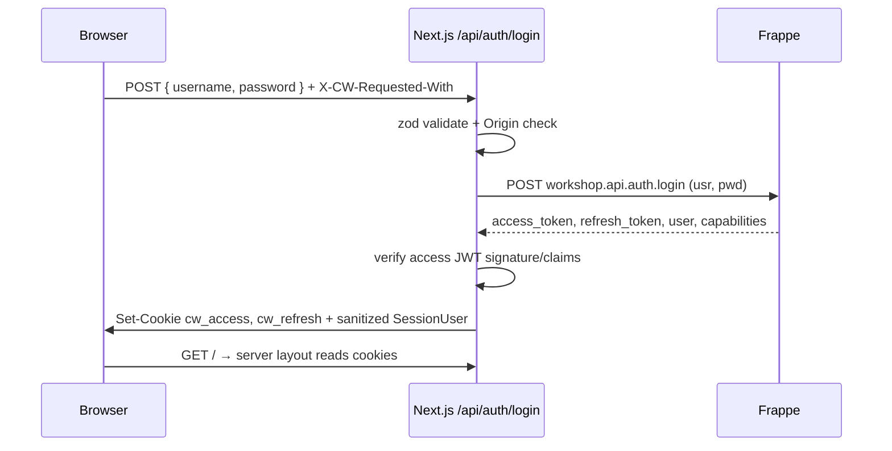

# Next.js Authentication Implementation Specification

**Project:** Continental Works workshop builder  
**Target app:** Next.js 15+ App Router, TypeScript  
**Backend:** Frappe custom app `continental_works` / `workshop.api.*`  
**Status:** Ready for implementation  
**Source requirements:** `instructions/Continental_Works_SRS_v2.md` — FR-AUTH-001..005, NFR-001..003

---

## 1. Purpose

Define the authentication and session layer for the headless Next.js application. This document is the handoff spec for implementation. It replaces the current Vite SPA client-only auth layer (`src/store/sessionStore.ts`, `src/routes/ProtectedRoute.tsx`, `src/services/workshopApi.ts`) with a server-owned Next.js App Router implementation.

**Security boundary:** Frappe. Next.js is a session broker and UX gate. Hiding a route or button is not authorization. Every data mutation and read must be enforced by Frappe RBAC and shop scoping.

---

## 2. Scope

### In scope

- Credentials login through Next.js Route Handler.
- Frappe JWT obtained server-side, stored in `HttpOnly` cookies.
- Server-side session verification in Server Components, Route Handlers, and Server Actions.
- Middleware for coarse redirects.
- Layout/page/server-action guards for role checks.
- Refresh token rotation.
- Logout with Frappe revocation plus local cookie clearing.
- Same-origin API proxy from Next.js to Frappe.
- CSRF defence for mutating Route Handlers.
- Role normalization and route matrix.
- Session provider for client components.
- Test and acceptance checklist.

### Out of scope

- OAuth, SSO, magic link, register, forgot-password.
- Client-side token storage.
- Frappe backend implementation details beyond the contract in §4.
- Audit log implementation — separate spec, but actor identity comes from this layer.

---

## 3. Key decisions

| Decision | Choice | Reason |
|---|---|---|
| Rendering | App Router, Server Components by default | SRS names Next.js; server-only secrets stay server-side |
| Auth library | Custom JWT layer using `jose` | SRS FR-AUTH-001 names Frappe JWT; no need for full Auth.js session store |
| Token storage | `HttpOnly`, `Secure`, `SameSite=Lax` cookies | No token exposed to JS; removes `localStorage` XSS risk |
| Client session | Server-provided user DTO in a React context | Client needs identity/roles, not tokens |
| API access | Next.js BFF `/api/[...path]` proxy | Central token injection, refresh, 401 handling, origin checks |
| Real authorization | Frappe RBAC + shop scoping | NFR-001, NFR-002 |
| CSRF | `SameSite=Lax` + `Origin` check + custom header on mutations | Route Handlers do not get Server Action CSRF for free |
| Middleware role check | Coarse only | Edge runtime has no DB; definitive check in server layout/page/action |

**Version note:** Next.js 15+ uses `middleware.ts`. If the project moves to a Next.js version where the file convention is `proxy.ts`, rename the file and keep the same logic. `cookies()` and `headers()` are async in Next.js 15+.

---

## 4. Backend contract — Frappe

Confirm these methods exist in the Frappe custom app. If Frappe uses its standard JWT endpoint instead, adapt `lib/auth/frappe.ts` only; the rest of this spec stays unchanged.

### 4.1 Login

`POST /api/method/workshop.api.auth.login`

```ts
type FrappeLoginResponse = {
  message: {
    access_token: string
    refresh_token: string
    token_type: 'Bearer'
    expires_in: number // seconds
    refresh_expires_in?: number
    user: {
      id: string
      fullName: string
      email: string
      mobile: string
      roleIds: string[]
      shopIds: string[]
      status: 'Active' | 'Inactive' | 'Suspended'
      createdAt: string
      updatedAt: string
    }
    capabilities: string[]
    siteName?: string
  }
}
```

- Username field: `usr`. Password field: `pwd`.
- Backend validates password using Frappe built-in hashing. NFR-003.
- Backend must reject inactive/suspended users.
- Never return password or hash.

### 4.2 Refresh

`POST /api/method/workshop.api.auth.refresh`

```ts
type FrappeRefreshResponse = {
  message: {
    access_token: string
    refresh_token: string
    expires_in: number
    refresh_expires_in?: number
  }
}
```

- Requires valid refresh token.
- Refresh token rotation mandatory. Reuse must revoke the family.
- On refresh failure: `401`.

### 4.3 Logout / revoke

`POST /api/method/workshop.api.auth.logout`

- Requires `Authorization: Bearer <access_token>`.
- Revokes access and refresh tokens server-side. FR-AUTH-005.
- Next.js clears cookies even if this call fails.

### 4.4 Session identity

`GET /api/method/workshop.api.auth.me`

Returns the same `user`, `capabilities`, `siteName` shape as login. Used during refresh recovery and token verification mismatch checks.

### 4.5 Data endpoints

All `workshop.api.*` data endpoints must:

- Accept `Authorization: Bearer <access_token>`.
- Return `401` for missing/expired/invalid token. FR-AUTH-002.
- Enforce Frappe role permissions. FR-AUTH-003, NFR-001.
- Enforce `shopIds` scoping. NFR-002.
- Treat `X-CW-Company` as a hint only; never trust it as authorization.

---

## 5. Environment variables

```env
# Frappe origin, no trailing slash
FRAPPE_URL=https://cw.elfbd.com

# Shared secret used by Frappe to sign JWTs (HS256 default)
AUTH_JWT_SECRET=replace-with-long-random-secret

# Optional when using RS256/JWKS instead of HS256
# AUTH_JWKS_URL=https://cw.elfbd.com/.well-known/jwks.json

AUTH_JWT_ISSUER=continental-works
AUTH_JWT_AUDIENCE=continental-works-nextjs

AUTH_ACCESS_TOKEN_TTL=900
AUTH_REFRESH_TOKEN_TTL=604800

# App URL used for Origin checks
NEXT_PUBLIC_APP_URL=http://localhost:3000

# Socket.IO, only if realtime is kept in Next.js phase
NEXT_PUBLIC_SOCKET_URL=https://cw.elfbd.com
NEXT_PUBLIC_SOCKET_PATH=/socket.io
NEXT_PUBLIC_SITE_NAME=cw.dotech.biz
```

Rules:

- No secrets in `NEXT_PUBLIC_*`.
- `AUTH_JWT_SECRET` must match Frappe JWT signing secret.
- Production cookies require HTTPS; `Secure` flag enabled when `NODE_ENV=production`.

---

## 6. Dependencies

```bash
npm install jose zod
```

Already expected: `next`, `react`, `react-dom`, `typescript`.

Do not install `next-auth` for this spec. Do not install JWT decode libraries that run in the browser.

---

## 7. Proposed file structure

```text
src/
├── app/
│   ├── (auth)/
│   │   └── login/
│   │       └── page.tsx
│   ├── (app)/
│   │   ├── layout.tsx                 # requireUser() + AppShell
│   │   ├── page.tsx                   # LandingRedirect
│   │   ├── admin/
│   │   │   ├── layout.tsx             # requireRole(['Admin'])
│   │   │   └── users/page.tsx
│   │   ├── guard/
│   │   │   ├── layout.tsx             # requireRole(['Guard'])
│   │   │   └── page.tsx
│   │   ├── jc/
│   │   │   ├── layout.tsx             # requireRole(['Job Creation'])
│   │   │   └── page.tsx
│   │   ├── cre/
│   │   │   ├── layout.tsx
│   │   │   └── page.tsx
│   │   ├── sa/
│   │   │   ├── layout.tsx
│   │   │   └── appointments/page.tsx
│   │   ├── technician/
│   │   │   ├── layout.tsx
│   │   │   └── page.tsx
│   │   ├── parts/
│   │   │   ├── layout.tsx
│   │   │   └── inventory/page.tsx
│   │   ├── notifications/page.tsx     # any authenticated user
│   │   └── ...
│   ├── api/
│   │   ├── auth/
│   │   │   ├── login/route.ts
│   │   │   ├── refresh/route.ts
│   │   │   ├── logout/route.ts
│   │   │   └── session/route.ts
│   │   └── [...path]/route.ts         # BFF proxy to Frappe
│   ├── layout.tsx                     # SessionProvider
│   └── not-found.tsx
├── components/
│   ├── auth/
│   │   ├── login-form.tsx
│   │   ├── logout-button.tsx
│   │   └── session-provider.tsx
│   └── app-shell.tsx
├── lib/
│   ├── auth/
│   │   ├── constants.ts
│   │   ├── types.ts
│   │   ├── roles.ts
│   │   ├── tokens.ts
│   │   ├── cookies.ts
│   │   ├── session.ts
│   │   ├── guards.ts
│   │   └── frappe.ts
│   └── api/
│       └── client.ts                  # browser fetch helper for /api
└── middleware.ts
```

---

## 8. Cookie and token specification

### 8.1 Cookies

| Name | Contents | HTTP only | Secure | SameSite | Path | TTL |
|---|---|---:|---:|---|---|---:|
| `cw_access` | Frappe access JWT | yes | prod only | `Lax` | `/` | 15 min |
| `cw_refresh` | Frappe refresh JWT | yes | prod only | `Lax` | `/api/auth` | 7 days |
| `cw_company` | selected company ID | no | prod only | `Lax` | `/` | 30 days |

- Refresh cookie path is `/api/auth` so browser never sends it to data routes.
- Access cookie sent to all same-origin `/api` calls.
- No tokens in `localStorage`, `sessionStorage`, or React state.
- `cw_company` is preference only, never authorization.

### 8.2 Cookie options

```ts
export const accessCookieOptions = {
  httpOnly: true,
  secure: process.env.NODE_ENV === 'production',
  sameSite: 'lax',
  path: '/',
  maxAge: Number(process.env.AUTH_ACCESS_TOKEN_TTL ?? 900),
} as const

export const refreshCookieOptions = {
  httpOnly: true,
  secure: process.env.NODE_ENV === 'production',
  sameSite: 'lax',
  path: '/api/auth',
  maxAge: Number(process.env.AUTH_REFRESH_TOKEN_TTL ?? 604800),
} as const
```

`lib/auth/cookies.ts`

```ts
import type { NextResponse } from 'next/server'
import { accessCookieOptions, refreshCookieOptions } from './constants'

type Tokens = { accessToken: string; refreshToken: string }

export function setAuthCookies(response: NextResponse, tokens: Tokens) {
  response.cookies.set('cw_access', tokens.accessToken, accessCookieOptions)
  response.cookies.set('cw_refresh', tokens.refreshToken, refreshCookieOptions)
}

export function clearAuthCookies(response: NextResponse) {
  response.cookies.set('cw_access', '', { ...accessCookieOptions, maxAge: 0 })
  response.cookies.set('cw_refresh', '', { ...refreshCookieOptions, maxAge: 0 })
}
```

### 8.3 JWT claims required

AccessToken payload must include:

```ts
type AccessTokenClaims = {
  sub: string          // Frappe user ID
  name?: string
  email?: string
  roles: string[]      // raw Frappe role IDs
  capabilities?: string[]
  shops?: string[]
  site?: string
  iss: string
  aud: string
  iat: number
  exp: number
  jti?: string
}
```

Verification:

- Signature using `AUTH_JWT_SECRET` with HS256, or JWKS with RS256.
- `issuer: AUTH_JWT_ISSUER`
- `audience: AUTH_JWT_AUDIENCE`
- `exp` enforced by `jose`.

If token contains only `sub`, call `workshop.api.auth.me` server-side to build the session. Cache the result per request only.

---

## 9. Types

`lib/auth/types.ts`

```ts
export type Role =
  | 'Admin'
  | 'Guard'
  | 'Job Creation'
  | 'CRE'
  | 'Service Advisor'
  | 'Service Engineer'
  | 'Technician'
  | 'QC'
  | 'Parts'
  | 'Procurement'
  | 'Accounts'

export type SessionUser = {
  id: string
  name: string
  email: string
  roles: Role[]
  rawRoleIds: string[]
  capabilities: string[]
  shopIds: string[]
  siteName?: string
  isAdministrator: boolean
  isWorkshopAdmin: boolean
}

export type Session =
  | { status: 'authenticated'; user: SessionUser }
  | { status: 'anonymous'; user: null }
```

---

## 10. Role normalization

`lib/auth/roles.ts`

Normalize Frappe role IDs once, server-side. Do not repeat this logic in UI components.

```ts
const RULES: Array<[Role, string[]]> = [
  ['Admin', ['Administrator', 'System Manager', 'Workshop Admin', 'Workshop Administrator', 'Admin', 'CW Admin']],
  ['Guard', ['Guard', 'CW Guard']],
  ['Job Creation', ['Job Creation', 'JC', 'Job Controller', 'CW Job Creation']],
  ['CRE', ['CRE', 'CW CRE']],
  ['Service Advisor', ['Service Advisor', 'SA', 'CW Service Advisor']],
  ['Service Engineer', ['Service Engineer', 'SE', 'CW Service Engineer']],
  ['Technician', ['Technician', 'CW Technician']],
  ['QC', ['QC', 'Quality Controller', 'CW QC']],
  ['Parts', ['Parts', 'CW Parts', 'Store Keeper', 'Picker', 'Estimator', 'Parts Buyer / Estimator', 'Parts Manager']],
  ['Procurement', ['Procurement', 'Procurement User', 'Procurement Manager', 'CW Procurement']],
  ['Accounts', ['Accounts', 'Accounts User', 'Accounts Manager', 'CW Accounts']],
]

export function normalizeRoles(rawRoleIds: string[], capabilities: string[] = []): Role[] {
  const raw = new Set(rawRoleIds.map((role) => role.toLowerCase()))
  const caps = new Set(capabilities)
  const roles = new Set<Role>()

  for (const [role, aliases] of RULES) {
    if (aliases.some((alias) => raw.has(alias.toLowerCase()))) roles.add(role)
  }

  if (caps.has('admin.read')) roles.add('Admin')

  return [...roles]
}

export function deriveElevation(id: string, rawRoleIds: string[]) {
  const raw = new Set(rawRoleIds.map((role) => role.toLowerCase()))
  return {
    isAdministrator: id === 'Administrator' || raw.has('administrator'),
    isWorkshopAdmin: raw.has('workshop admin') || raw.has('workshop administrator'),
  }
}
```

**Fix from current Vite app:** `Procurement` and `Accounts` are added here. Current `roleFromBackend()` never emits them, so those routes are unreachable for plain holders.

**Elevation semantics:**

- `isAdministrator` and `isWorkshopAdmin` bypass all Next.js layout/page role checks.
- Plain `Admin` can access `/admin` and all nested `/admin/*` paths. Use prefix matching, not exact path. Current Vite `RequireRole` denies `/admin/users` for plain Admin — do not copy that bug.

---

## 11. Core flows

### 11.1 Login



### 11.2 Session restore

No client bootstrap spinner for session discovery. Server Components read cookies directly.

```ts
const session = await getSession()
if (session.status === 'anonymous') redirect('/login')
```

Client components receive user via `SessionProvider` in root layout.

### 11.3 Refresh

```mermaid
sequenceDiagram
    participant B as Browser
    participant P as /api/[...path]
    participant N as /api/auth/refresh
    participant F as Frappe

    B->>P: GET/POST /api/workshop.api.foo with cw_access
    P->>P: verify access; expired
    P->>N: internal refresh() using cw_refresh
    N->>F: POST workshop.api.auth.refresh (refresh_token)
    F-->>N: new access + refresh (rotated)
    N->>B: Set-Cookie new cw_access, cw_refresh
    P->>F: retry original request with new access
    F-->>P: data
```

- Refresh only inside Route Handlers/Server Actions, never client-side.
- If refresh fails: clear cookies, return `401` for API or redirect for pages.

### 11.4 Logout

1. Client calls `POST /api/auth/logout` with custom header.
2. Route Handler sends revoke call to Frappe with access token.
3. Delete `cw_access` and `cw_refresh` regardless of Frappe response.
4. Client router replaces to `/login`.

---

## 12. Server helpers

`lib/auth/tokens.ts`

```ts
import { jwtVerify, SignJWT } from 'jose'
import type { AccessTokenClaims, SessionUser } from './types'
import { normalizeRoles, deriveElevation } from './roles'

const secret = new TextEncoder().encode(process.env.AUTH_JWT_SECRET)

export async function verifyAccessToken(token: string): Promise<AccessTokenClaims | null> {
  try {
    const { payload } = await jwtVerify(token, secret, {
      issuer: process.env.AUTH_JWT_ISSUER,
      audience: process.env.AUTH_JWT_AUDIENCE,
      algorithms: ['HS256'],
    })
    return payload as unknown as AccessTokenClaims
  } catch {
    return null
  }
}

export async function createOpaqueRefreshJti(): Promise<string> {
  return crypto.randomUUID()
}
```

For RS256/JWKS, replace `jwtVerify` with `createRemoteJWKSet(new URL(process.env.AUTH_JWKS_URL!))`. Keep the same `verifyAccessToken` signature.

`lib/auth/session.ts`

```ts
import { cookies } from 'next/headers'
import { redirect } from 'next/navigation'
import { verifyAccessToken } from './tokens'
import { normalizeRoles, deriveElevation } from './roles'
import type { Session, SessionUser } from './types'

export async function getSession(): Promise<Session> {
  const cookieStore = await cookies()
  const token = cookieStore.get('cw_access')?.value
  if (!token) return { status: 'anonymous', user: null }

  const claims = await verifyAccessToken(token)
  if (!claims) return { status: 'anonymous', user: null }

  const rawRoleIds = claims.roles ?? []
  const elevation = deriveElevation(claims.sub, rawRoleIds)

  const user: SessionUser = {
    id: claims.sub,
    name: claims.name ?? claims.email ?? claims.sub,
    email: claims.email ?? '',
    roles: normalizeRoles(rawRoleIds, claims.capabilities ?? []),
    rawRoleIds,
    capabilities: claims.capabilities ?? [],
    shopIds: claims.shops ?? [],
    siteName: claims.site ?? process.env.NEXT_PUBLIC_SITE_NAME,
    ...elevation,
  }

  return { status: 'authenticated', user }
}

export async function requireUser(): Promise<SessionUser> {
  const session = await getSession()
  if (session.status === 'anonymous') redirect('/login')
  return session.user
}

export async function requireRole(allowed: Role[]): Promise<SessionUser> {
  const user = await requireUser()
  if (user.isAdministrator || user.isWorkshopAdmin) return user

  const ok = user.roles.some((role) => allowed.includes(role))
  if (!ok) redirect('/')
  return user
}
```

`lib/auth/guards.ts` for Route Handlers and Server Actions:

```ts
import { getSession } from './session'
import type { Role } from './types'

export async function requireApiUser() {
  const session = await getSession()
  if (session.status === 'anonymous') {
    return { ok: false as const, response: Response.json({ error: 'Unauthorized' }, { status: 401 }) }
  }
  return { ok: true as const, user: session.user }
}

export async function requireApiRole(allowed: Role[]) {
  const result = await requireApiUser()
  if (!result.ok) return result

  const { user } = result
  if (user.isAdministrator || user.isWorkshopAdmin) return result
  if (user.roles.some((role) => allowed.includes(role))) return result

  return { ok: false as const, response: Response.json({ error: 'Forbidden' }, { status: 403 }) }
}
```

### 12.1 Frappe auth client

`lib/auth/frappe.ts` — server-only. Never import from a `'use client'` file.

```ts
export type FrappeTokens = { accessToken: string; refreshToken: string }
type FrappeUser = {
  id: string
  fullName: string
  email: string
  roleIds: string[]
  capabilities: string[]
  shopIds: string[]
  siteName?: string
}

const base = process.env.FRAPPE_URL

async function post(method: string, body: unknown, token?: string) {
  return fetch(`${base}/api/method/${method}`, {
    method: 'POST',
    headers: {
      'Content-Type': 'application/json',
      ...(token ? { Authorization: `Bearer ${token}` } : {}),
    },
    body: JSON.stringify(body),
    cache: 'no-store',
  })
}

export async function frappeLogin(username: string, password: string) {
  const response = await post('workshop.api.auth.login', { usr: username, pwd: password })
  if (!response.ok) {
    return { ok: false as const, status: response.status, error: 'Invalid username or password' }
  }
  const { message } = await response.json()
  return {
    ok: true as const,
    tokens: {
      accessToken: message.access_token,
      refreshToken: message.refresh_token,
    } satisfies FrappeTokens,
    user: {
      id: message.user.id,
      fullName: message.user.fullName,
      email: message.user.email,
      roleIds: message.user.roleIds ?? [],
      capabilities: message.capabilities ?? [],
      shopIds: message.user.shopIds ?? [],
      siteName: message.siteName,
    } satisfies FrappeUser,
  }
}

export async function frappeRefresh(refreshToken: string) {
  const response = await post('workshop.api.auth.refresh', {
    refresh_token: refreshToken,
  })
  if (!response.ok) return { ok: false as const }
  const { message } = await response.json()
  return {
    ok: true as const,
    tokens: {
      accessToken: message.access_token,
      refreshToken: message.refresh_token,
    } satisfies FrappeTokens,
  }
}

export async function frappeLogout(accessToken: string) {
  try {
    await post('workshop.api.auth.logout', {}, accessToken)
  } catch {
    // Local cookies are cleared by the caller regardless.
  }
}
```

If Frappe expects form-urlencoded `usr`/`pwd` instead of JSON, change only `post()` for the login call. Keep the return shape identical.

---

## 13. Route Handlers

`app/api/auth/login/route.ts`

```ts
import { NextRequest, NextResponse } from 'next/server'
import { z } from 'zod'
import { setAuthCookies } from '@/lib/auth/cookies'
import { frappeLogin } from '@/lib/auth/frappe'
import { verifyAccessToken } from '@/lib/auth/tokens'
import { normalizeRoles, deriveElevation } from '@/lib/auth/roles'
import { assertSameOrigin, assertAuthHeader } from '@/lib/auth/csrf'

const schema = z.object({
  username: z.string().trim().min(1).max(140),
  password: z.string().min(1).max(200),
})

export async function POST(request: NextRequest) {
  assertSameOrigin(request)
  assertAuthHeader(request)

  const parsed = schema.safeParse(await request.json())
  if (!parsed.success) {
    return NextResponse.json({ error: 'Invalid credentials payload' }, { status: 400 })
  }

  const result = await frappeLogin(parsed.data.username, parsed.data.password)
  if (!result.ok) {
    return NextResponse.json({ error: result.error }, { status: result.status })
  }

  const claims = await verifyAccessToken(result.tokens.accessToken)
  if (!claims) {
    return NextResponse.json({ error: 'Invalid token from auth server' }, { status: 502 })
  }

  const rawRoleIds = claims.roles ?? result.user.roleIds
  const response = NextResponse.json({
    user: {
      ...result.user,
      roles: normalizeRoles(rawRoleIds, result.user.capabilities),
      rawRoleIds,
      ...deriveElevation(result.user.id, rawRoleIds),
    },
  })

  setAuthCookies(response, result.tokens)
  return response
}
```

Rules:

- Never log request body.
- Generic error message for bad credentials. No user enumeration.
- Rate limit at Next.js edge/proxy and at Frappe.

`app/api/auth/refresh/route.ts`

```ts
export async function POST(request: NextRequest) {
  assertSameOrigin(request)
  assertAuthHeader(request)

  const refreshToken = request.cookies.get('cw_refresh')?.value
  if (!refreshToken) {
    return NextResponse.json({ error: 'Unauthorized' }, { status: 401 })
  }

  const result = await frappeRefresh(refreshToken)
  if (!result.ok) {
    const response = NextResponse.json({ error: 'Unauthorized' }, { status: 401 })
    clearAuthCookies(response)
    return response
  }

  const response = NextResponse.json({ ok: true })
  setAuthCookies(response, result.tokens)
  return response
}
```

`app/api/auth/logout/route.ts`

```ts
export async function POST(request: NextRequest) {
  assertSameOrigin(request)
  assertAuthHeader(request)

  const accessToken = request.cookies.get('cw_access')?.value
  if (accessToken) await frappeLogout(accessToken)

  const response = NextResponse.json({ ok: true })
  clearAuthCookies(response)
  return response
}
```

`app/api/auth/session/route.ts`

```ts
export async function GET() {
  const session = await getSession()
  return NextResponse.json(
    { status: session.status, user: session.user },
    { headers: { 'Cache-Control': 'no-store' } }
  )
}
```

### 13.1 BFF proxy

`app/api/[...path]/route.ts`

- Only allow `GET`, `POST`, `PUT`, `PATCH`, `DELETE`.
- Build Frappe URL from `params.path`; reject `..` segments.
- Forward `Content-Type`, `X-CW-Company`, `X-CW-Requested-With`.
- Never forward browser `Cookie` header to Frappe.
- Attach `Authorization: Bearer <access>`.
- On upstream `401`, call `frappeRefresh()` once, set rotated cookies on the final response, retry once.
- On retry `401`, clear cookies and return `401`.

Pseudo-skeleton:

```ts
const methods = ['GET', 'POST', 'PUT', 'PATCH', 'DELETE'] as const

export async function handler(request: NextRequest, context: { params: Promise<{ path: string[] }> }) {
  assertSameOrigin(request)
  if (request.method !== 'GET') assertAuthHeader(request)

  const { path } = await context.params
  if (path.some((segment) => segment === '..')) {
    return NextResponse.json({ error: 'Invalid path' }, { status: 400 })
  }

  const guard = await requireApiUser()
  if (!guard.ok) return guard.response

  const body = request.method === 'GET' ? undefined : await request.arrayBuffer()
  const company = request.headers.get('x-cw-company')

  const call = (token: string) =>
    fetch(`${process.env.FRAPPE_URL}/api/method/${path.join('/')}${request.nextUrl.search}`, {
      method: request.method,
      headers: {
        Authorization: `Bearer ${token}`,
        ...(request.headers.get('content-type')
          ? { 'Content-Type': request.headers.get('content-type')! }
          : {}),
        ...(company ? { 'X-CW-Company': company } : {}),
      },
      body,
      cache: 'no-store',
    })

  let access = request.cookies.get('cw_access')?.value!
  let upstream = await call(access)
  let rotated: FrappeTokens | null = null

  if (upstream.status === 401) {
    const refresh = request.cookies.get('cw_refresh')?.value
    const refreshed = refresh ? await frappeRefresh(refresh) : null
    if (!refreshed?.ok) {
      const response = NextResponse.json({ error: 'Unauthorized' }, { status: 401 })
      clearAuthCookies(response)
      return response
    }
    access = refreshed.tokens.accessToken
    rotated = refreshed.tokens
    upstream = await call(access)
  }

  const data = await upstream.arrayBuffer()
  const response = new NextResponse(data, {
    status: upstream.status,
    headers: {
      'Content-Type': upstream.headers.get('content-type') ?? 'application/json',
      'Cache-Control': 'no-store',
    },
  })

  if (rotated) setAuthCookies(response, rotated)
  return response
}

export const GET = handler
export const POST = handler
export const PUT = handler
export const PATCH = handler
export const DELETE = handler
```

Client calls only same-origin paths:

```ts
await fetch('/api/workshop.api.users.list', {
  credentials: 'same-origin',
  headers: { 'X-CW-Requested-With': 'cw-nextjs' },
})
```

---

## 14. CSRF

`lib/auth/csrf.ts`

```ts
export function assertSameOrigin(request: Request) {
  const origin = request.headers.get('origin')
  if (!origin) return

  const expected = new URL(process.env.NEXT_PUBLIC_APP_URL ?? '').origin
  if (origin !== expected) throw new Error('Invalid origin')
}

export function assertAuthHeader(request: Request) {
  if (request.headers.get('x-cw-requested-with') !== 'cw-nextjs') {
    throw new Error('Missing CSRF header')
  }
}
```

Wrap these calls in a helper that returns `403` instead of throwing raw errors in production.

Rules:

- No state changes on `GET`.
- `SameSite=Lax` blocks most cross-site POST cookie sends.
- `Origin` + custom header blocks form posts and simple cross-origin fetches.
- Server Actions get Next.js CSRF protection automatically; use them where practical for mutations.
- File uploads follow the same proxy and header rules.

---

## 15. Middleware

`middleware.ts`

```ts
import { NextRequest, NextResponse } from 'next/server'
import { verifyAccessToken } from '@/lib/auth/tokens'
import { normalizeRoles, deriveElevation } from '@/lib/auth/roles'
import type { Role } from '@/lib/auth/types'

const PUBLIC_PATHS = [
  '/login',
  '/api/auth/login',
  '/api/auth/session',
  '/api/auth/refresh', // must allow expired access token through
]

const ROLE_PATHS: Array<[string, Role[]]> = [
  ['/admin', ['Admin']],
  ['/guard', ['Guard']],
  ['/jc', ['Job Creation']],
  ['/cre', ['CRE']],
  ['/sa', ['Service Advisor']],
  ['/se', ['Service Engineer']],
  ['/technician', ['Technician']],
  ['/qc', ['QC']],
  ['/parts', ['Parts', 'Procurement', 'Accounts', 'Admin']],
  ['/procurement', ['Procurement', 'Accounts', 'Admin']],
  ['/accounting', ['Accounts', 'Admin']],
]

export async function middleware(request: NextRequest) {
  const { pathname, search } = request.nextUrl
  if (PUBLIC_PATHS.includes(pathname)) return NextResponse.next()

  const isApi = pathname.startsWith('/api/')
  const token = request.cookies.get('cw_access')?.value
  const claims = token ? await verifyAccessToken(token) : null

  if (!claims) {
    if (isApi) return NextResponse.json({ error: 'Unauthorized' }, { status: 401 })
    const loginUrl = new URL('/login', request.url)
    loginUrl.searchParams.set('next', `${pathname}${search}`)
    return NextResponse.redirect(loginUrl)
  }

  const roles = normalizeRoles(claims.roles ?? [], claims.capabilities ?? [])
  const elevation = deriveElevation(claims.sub, claims.roles ?? [])

  for (const [prefix, allowed] of ROLE_PATHS) {
    if (pathname === prefix || pathname.startsWith(`${prefix}/`)) {
      if (elevation.isAdministrator || elevation.isWorkshopAdmin) continue
      if (!roles.some((role) => allowed.includes(role))) {
        if (isApi) return NextResponse.json({ error: 'Forbidden' }, { status: 403 })
        return NextResponse.redirect(new URL('/', request.url))
      }
    }
  }

  return NextResponse.next()
}

export const config = {
  matcher: ['/((?!_next/static|_next/image|favicon.ico|.*\\..*).*)'],
}
```

Notes:

- Middleware checks JWT claims only. No DB call.
- Definitive checks still live in `app/(app)/.../layout.tsx` and in Server Actions via `requireRole()`.
- `jose` is Edge-compatible. Do not import Node `crypto` modules here.
- `/api/auth/refresh` is listed in `PUBLIC_PATHS` so a missing/expired access token does not block refresh. The refresh cookie itself is still required by the handler.

---

## 16. Layouts and pages

`app/layout.tsx`

```tsx
import { SessionProvider } from '@/components/auth/session-provider'
import { getSession } from '@/lib/auth/session'

export default async function RootLayout({ children }: { children: React.ReactNode }) {
  const session = await getSession()
  return (
    <html lang="en">
      <body>
        <SessionProvider
          user={session.status === 'authenticated' ? session.user : null}
        >
          {children}
        </SessionProvider>
      </body>
    </html>
  )
}
```

`app/(app)/layout.tsx`

```tsx
import { requireUser } from '@/lib/auth/session'
import { AppShell } from '@/components/app-shell'

export default async function AppLayout({ children }: { children: React.ReactNode }) {
  const user = await requireUser()
  return <AppShell user={user}>{children}</AppShell>
}
```

`app/(app)/admin/layout.tsx`

```tsx
import { requireRole } from '@/lib/auth/session'

export default async function AdminLayout({ children }: { children: React.ReactNode }) {
  await requireRole(['Admin'])
  return <>{children}</>
}
```

For a page needing broader access:

```tsx
await requireRole(['Job Creation', 'Service Advisor', 'CRE'])
```

For Server Actions:

```ts
'use server'

export async function createJob(input: JobInput) {
  const user = await requireRole(['Job Creation', 'Service Advisor', 'CRE'])
  // Frappe still enforces final permission using the forwarded JWT.
  return frappeMutate('workshop.api.jobs.create', input, user)
}
```

---

## 17. Client session provider

`components/auth/session-provider.tsx`

```tsx
'use client'

import { createContext, useContext } from 'react'
import type { SessionUser } from '@/lib/auth/types'

const SessionContext = createContext<SessionUser | null>(null)

export function SessionProvider({
  user,
  children,
}: {
  user: SessionUser | null
  children: React.ReactNode
}) {
  return <SessionContext.Provider value={user}>{children}</SessionContext.Provider>
}

export function useSessionUser() {
  return useContext(SessionContext)
}
```

Rules:

- Provider carries `SessionUser` only. No tokens.
- Never derive authorization from context. Use it for display and nav filtering.
- After logout/login, call `router.refresh()` so Server Components re-read cookies.
- If a 401 comes from `/api`, `client.ts` calls `router.push('/login?next=...')`.

---

## 18. Route and role matrix

| Path prefix | Allowed frontend roles | Notes |
|---|---|---|
| `/login` | public | Redirect to `/` if already authenticated |
| `/` | authenticated | `LandingRedirect` by first role |
| `/admin/**` | `Admin` | Prefix match. Elevation bypasses |
| `/guard/**` | `Guard` | Tablet-first UI |
| `/jc/**` | `Job Creation` | `/jc/jobs/**` also allows `Service Advisor`, `CRE` |
| `/cre/**` | `CRE` | Appointment detail also allows `Service Advisor`, `Admin` |
| `/sa/**` | `Service Advisor` | |
| `/se/**` | `Service Engineer` | |
| `/technician/**` | `Technician` | |
| `/qc/**` | `QC` | |
| `/parts/inventory`, `/parts/counter-desk`, `/parts/estimator` | `Parts`, `Admin` | |
| `/parts/part-requests` | `Parts`, `Procurement`, `Admin` | |
| `/parts/purchase-orders`, `/parts/vendors` | `Procurement`, `Admin` | |
| `/procurement`, `/accounting` | `Procurement`, `Accounts`, `Admin` | |
| `/test-drives` | `Admin`, `Job Creation`, `Guard`, `CRE`, `Service Advisor`, `Service Engineer` | |
| `/service-orders` | `Admin`, `Job Creation`, `CRE`, `Service Advisor`, `Service Engineer`, `Accounts`, `Procurement` | |
| `/tasks`, `/calendar` | `Technician`, `Service Advisor`, `Service Engineer`, `Admin`, `Job Creation` | |
| `/vehicle-history/**` | `Admin`, `Job Creation`, `CRE` | |
| `/employee-records/**` | `Admin`, `Job Creation` | |
| `/notifications` | any authenticated user | |
| `/mock-procurement/**` | any authenticated user | Dev/demo only; remove before production |

Landing order:

```ts
const LANDING: Array<[Role, string]> = [
  ['Admin', '/admin'],
  ['Job Creation', '/jc'],
  ['Guard', '/guard'],
  ['CRE', '/cre'],
  ['Service Advisor', '/sa/appointments'],
  ['Service Engineer', '/se/appointments'],
  ['Technician', '/technician'],
  ['QC', '/qc/appointments'],
  ['Parts', '/parts/inventory'],
  ['Procurement', '/parts/purchase-orders'],
  ['Accounts', '/accounting'],
]
```

---

## 19. Error handling

| Case | Page behavior | API behavior |
|---|---|---|
| No access cookie | Redirect `/login?next=...` | `401` JSON |
| Invalid/expired access, valid refresh | Silent refresh, continue | Silent refresh, continue |
| Invalid/expired refresh | Clear cookies, redirect `/login` | `401`, clear cookies |
| Wrong role | Redirect `/` | `403` JSON |
| Frappe down / 5xx | Error boundary, retry | `502` JSON |
| Validation error | Form error | `400` JSON |
| CSRF/origin failure | `403` | `403` |

- Do not show raw backend errors to users.
- Log correlation ID server-side only.
- No redirect loop: `/login` must stay public.

---

## 20. Login page requirements

- Route: `app/(auth)/login/page.tsx`.
- Client form component posting to `/api/auth/login`.
- Fields: username, password. No prefilled credentials. Current Vite page hardcodes `Administrator` / `admin` — remove.
- Read `searchParams.next`; on success `router.replace(safeNext ?? '/')`.
- Validate `next` starts with `/` and not `//` to avoid open redirect.
- Already authenticated users: server component checks `getSession()` and redirects to `/`.
- Error states: invalid credentials, locked/suspended user, network failure.
- Disable submit while pending.
- No register/forgot-password/OAuth UI.

---

## 21. Logout UI

`components/auth/logout-button.tsx`

```tsx
'use client'

export function LogoutButton() {
  const router = useRouter()
  const [pending, setPending] = React.useState(false)

  async function logout() {
    setPending(true)
    try {
      await fetch('/api/auth/logout', {
        method: 'POST',
        credentials: 'same-origin',
        headers: { 'X-CW-Requested-With': 'cw-nextjs' },
      })
      router.replace('/login')
      router.refresh()
    } finally {
      setPending(false)
    }
  }

  return <button onClick={logout} disabled={pending}>Sign out</button>
}
```

---

## 22. Realtime / Socket.IO

If realtime stays in the Next.js phase:

- Connect only when `SessionProvider` has a user.
- Use `withCredentials: true`; do not send JWT in socket query string.
- Socket server must validate Frappe session/JWT server-side.
- Namespace from `session.siteName ?? NEXT_PUBLIC_SITE_NAME`.
- Heartbeat every 30s to `workshop.api.users.heartbeat`.
- Disconnect on logout.

---

## 23. Testing checklist

### Unit

- `normalizeRoles()` maps every alias from §10, including `Procurement` and `Accounts`.
- `deriveElevation()` handles `Administrator`, `Workshop Admin`, plain `Admin`.
- `verifyAccessToken()` rejects bad signature, wrong issuer, wrong audience, expired token.
- Cookie options set `HttpOnly`, `Secure` in prod, correct `Path`.
- `next` redirect validation rejects `//evil.com` and `https://evil.com`.

### Integration

- Login sets both cookies; response contains no token.
- Bad password returns `401`/generic error, no cookies.
- `/api/auth/session` returns anonymous without cookie.
- Expired access + valid refresh rotates both cookies and retries request.
- Reused refresh token fails and clears cookies.
- Logout revokes server token and deletes cookies even when Frappe call fails.
- CSRF: missing custom header gets `403`; wrong `Origin` gets `403`.
- Proxy does not forward `Cookie` header to Frappe.
- Proxy rejects `..` in path segment.

### E2E

- Unauthenticated visit to `/admin/users` → `/login?next=/admin/users` → login → back to `/admin/users`.
- Plain `Admin` can open `/admin/users` (regression for current Vite bug).
- `Guard` visiting `/admin` → `/`.
- `Procurement` user can open `/parts/purchase-orders`.
- `Accounts` user can open `/accounting`.
- Session survives full page reload without client bootstrap spinner.
- After session expiry, next API call refreshes silently; after refresh expiry, redirect to login.
- Logout clears access; back button cannot render protected data from cache. Set `Cache-Control: no-store` on all authenticated responses.

---

## 24. Acceptance criteria

Traceability to SRS:

| Requirement | Acceptance |
|---|---|
| FR-AUTH-001 | Login exchanges credentials with Frappe and stores JWT in HttpOnly cookies; no client token storage |
| FR-AUTH-002 | All `/api/**` return `401` without valid session; Frappe also rejects unauthenticated calls |
| FR-AUTH-003 | `requireRole()` guards layouts/pages/actions; Frappe enforces same roles server-side |
| FR-AUTH-004 | Middleware redirects unauthenticated protected routes to `/login?next=...` |
| FR-AUTH-005 | Logout revokes tokens at Frappe and deletes both cookies |
| NFR-001 | No mutation relies on UI hiding only |
| NFR-002 | `shopIds` from token used for display filtering; Frappe enforces cross-shop denial |
| NFR-003 | No password stored or logged by Next.js; Frappe handles hashing |

Definition of done:

- No token in browser storage.
- No password in logs.
- All authenticated responses `no-store`.
- Full test checklist passing.
- Current Vite auth files removed or archived after cutover.

---

## 25. Migration from current Vite app

| Current file | Next.js replacement |
|---|---|
| `src/store/sessionStore.ts` | `lib/auth/session.ts` + `components/auth/session-provider.tsx` |
| `src/components/AuthBootstrap.tsx` | Server Component `getSession()` in layouts; no bootstrap gate |
| `src/routes/ProtectedRoute.tsx` | `middleware.ts` + `requireUser()` / `requireRole()` |
| `src/routes/AppRouter.tsx` | `app/(app)/**` route groups |
| `src/services/workshopApi.ts` login/me/logout | `app/api/auth/**` Route Handlers |
| `src/services/workshopApi.ts` generic API calls | `app/api/[...path]/route.ts` + `lib/api/client.ts` |
| `src/pages/LoginPage.tsx` | `app/(auth)/login/page.tsx` |
| `src/store/companyStore.ts` | `cw_company` cookie + `X-CW-Company` header, Frappe validates |
| `src/components/RealtimeNotifications.tsx` | Session-gated socket client |

Do not carry over: prefilled credentials, CSRF fallback `'none'`, exact-path Admin restriction, missing Procurement/Accounts roles, client-only guards.

---

## 26. Open questions for backend owner

1. Exact Frappe JWT endpoint and token response shape — custom `workshop.api.auth.*` or Frappe standard?
2. Token signing algorithm — HS256 shared secret or RS256/JWKS?
3. Does refresh token rotation invalidate the whole family on reuse?
4. Does `workshop.api.auth.logout` revoke both access and refresh?
5. Are roles embedded in the JWT at issue time, or must Next.js call `me` on every request?
6. Can Frappe accept `X-CW-Company` for shop context, and does it re-validate against `shopIds`?
7. Should `/mock-procurement/**` ship to production?
